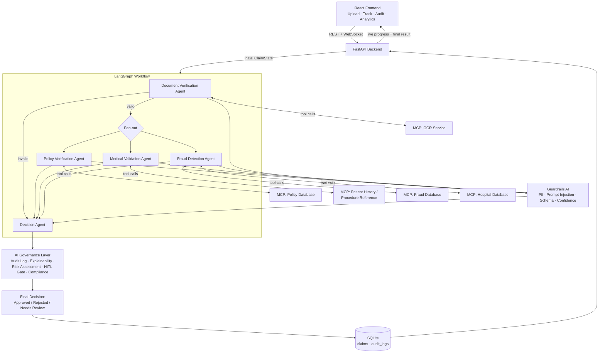

# Architecture

## 1. System flowchart

## 2. Component-by-component explanation

### React Frontend
Talks only to FastAPI — never to the LLM, MCP servers, or database
directly. Two channels: plain REST for CRUD-style calls (upload, status,
audit, dashboard) and a WebSocket (`/api/ws/claims/{id}/process`) for
streaming live per-stage progress into the pipeline-rail visualization.

### FastAPI Backend
Thin orchestration layer. Validates uploads (extension, size, non-empty),
applies role-based access control, persists claim records, and hands off
to the LangGraph workflow. It does not itself make any claims decisions —
its only "logic" is plumbing and validation.

### LangGraph Workflow Engine
The stateful core. A single `ClaimState` TypedDict is threaded through
every node; each agent reads what it needs and returns only the keys it
changed, which LangGraph merges automatically. This is the only channel
through which agents "talk" to each other — there is no direct
agent-to-agent messaging, by design, so the full inter-agent conversation
is always visible in one place (the state object) for audit purposes.

- **Conditional edge**: if `document_verification.is_valid` is `False`,
  the graph skips straight to the Decision Agent — there's no point
  running policy/medical/fraud checks against a claim with no valid
  supporting document.
- **Parallel fan-out**: policy, medical, and fraud checks have no
  dependency on each other, so LangGraph executes them in the same
  superstep — genuine concurrency, not just three sequential calls.
- **Retries**: every node is wrapped in `with_retries` (see
  `graph/workflow.py`), which retries up to 2 times with backoff before
  degrading to a safe, review-forcing default rather than crashing the
  claim.
- **Memory / checkpointing**: `MemorySaver` persists state after every
  superstep, keyed by `claim_id` — so a claim's execution can be
  inspected or replayed.

### The 5 Agents
Each agent follows the same pattern: **fetch ground truth via MCP tools →
ask the local LLM to reason over those facts → validate the LLM's output
against Guardrails → log everything to Governance.** The LLM is never the
source of a fact — only of the narrative summary and a confidence
estimate. See `agents/*.py` docstrings for each agent's specific
responsibilities and tool usage.

### MCP Tool Servers
Five standalone processes (`mcp_servers/*.py`), each built with the
official `mcp` Python SDK's `FastMCP` and launched over **stdio** by
`langchain-mcp-adapters`. Agents obtain LangChain `Tool` objects through
`mcp_client/client.py` and never import server internals directly —
swapping OCR engines or pointing the Policy server at a different
database requires zero agent code changes.

| MCP server | Tools exposed |
|---|---|
| OCR Service | `validate_document_integrity`, `extract_document_text`, `extract_claim_fields` |
| Policy Database | `get_policy_details`, `check_procedure_coverage`, `check_sufficient_balance` |
| Hospital Database | `get_hospital_details`, `is_in_network` |
| Fraud Database | `list_fraud_patterns`, `check_duplicate_claims`, `score_claim_risk` |
| Patient History | `get_patient_history`, `get_procedure_reference` |

### Guardrails AI
Custom, fully local/offline `Validator` subclasses registered with the
real `guardrails-ai` runtime (no Guardrails Hub network calls):
PII detection, prompt-injection detection (scans OCR text and any field
that gets interpolated into a prompt), per-agent JSON schema validation
(pydantic models), and confidence-range validation. See
`guardrails_engine/validators.py`.

### AI Governance
Cross-cutting layer (`governance/audit.py`) providing:
- **Audit logging** — every agent action written to SQLite *and* an
  append-only JSONL file (`logs/audit_log.jsonl`).
- **Explainability** — a structured, per-agent summary of why the final
  decision was made (`build_explainability_report`).
- **Confidence scoring** — blended mean across all four upstream agents.
- **Risk assessment** — aggregate low/medium/high risk level.
- **Human-in-the-loop** — hard rule: mid-range confidence, insufficient
  balance, implausible medical claims, or claims above the auto-approval
  ceiling are always routed to `needs_review`, regardless of what any
  agent or the LLM concluded.
- **Policy compliance** — a final gate that can *downgrade* (never
  silently upgrade) a decision if it violates a hard business rule (e.g.
  an "approved" claim against an inactive policy is impossible by
  construction).

### Decision
Deterministic Python function (`agents/decision_agent.py:_deterministic_decision`).
The LLM is asked only to phrase the explanation — never to choose the
verdict — which is what makes this safe to run on a 1B-parameter local
model.

### Dashboard
Recent claims, live stats, decision-mix and procedure-volume charts, and
average blended confidence — all served from `/api/dashboard/stats` and
`/api/claims`.
