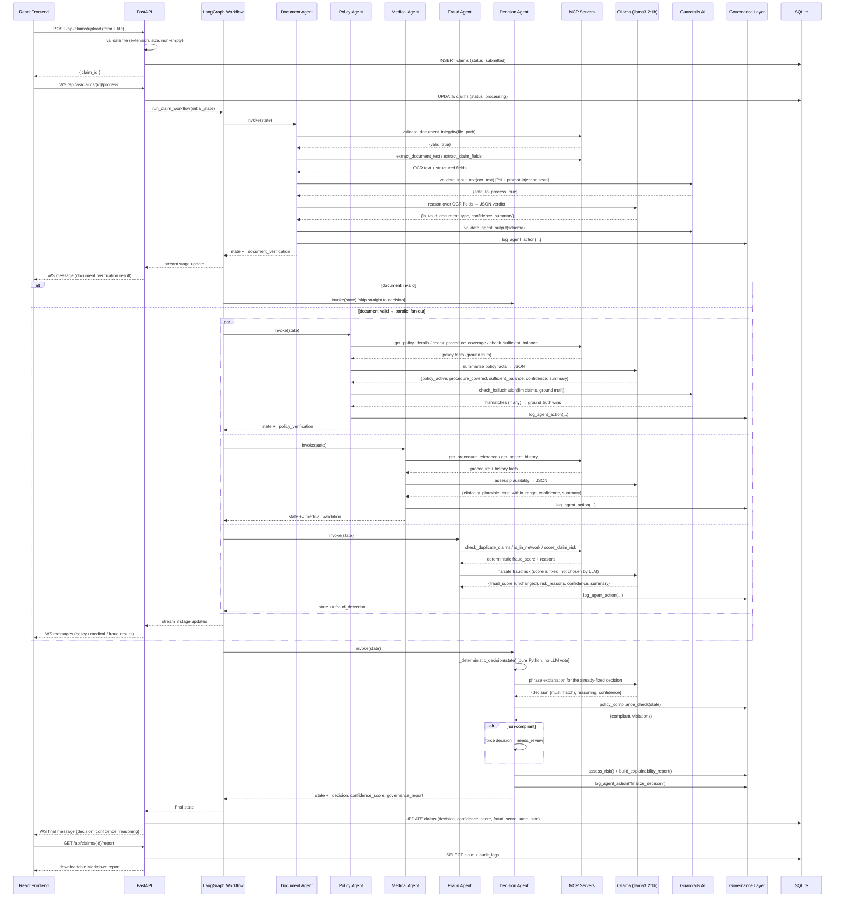

# Sequence Diagram — End-to-End Claim Processing

## Notes on the diagram

- The **parallel block** (`par ... and ... and ... end`) is a literal
  LangGraph superstep — `policy_verification`, `medical_validation`, and
  `fraud_detection` all fire concurrently because none of them depends on
  another's output, only on the document-verification stage that
  preceded them.
- **Guardrails AI appears twice per agent**: once on *input* (PII /
  prompt-injection scanning of OCR text before it ever reaches the LLM)
  and once on *output* (schema + confidence-range validation of what the
  LLM returned). The hallucination check is a third guardrail specific to
  agents that receive both LLM claims and independently-fetched ground
  truth (Policy, Medical).
- **The Decision Agent's LLM call cannot change the outcome.** Its JSON
  response is discarded and replaced with a deterministic fallback
  explanation if it disagrees with the already-computed `decision` value.
  This is the key safety property that makes a 1B local model acceptable
  for this workflow.
